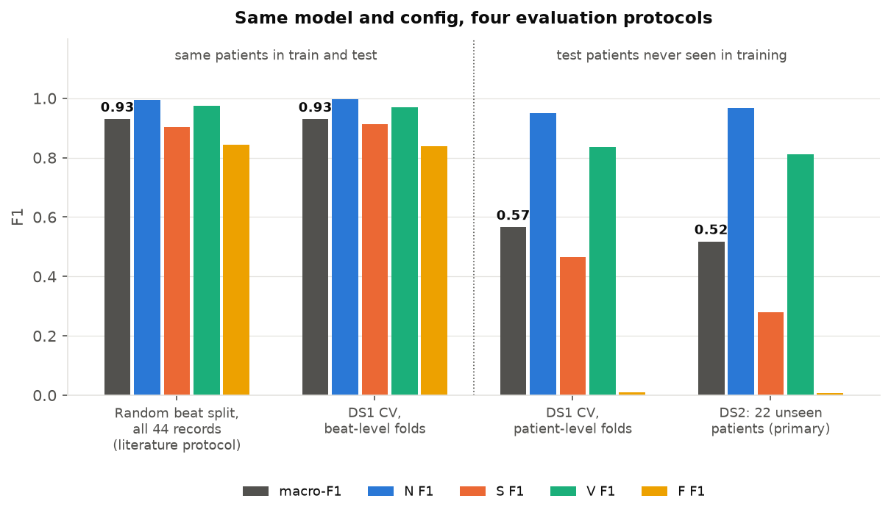
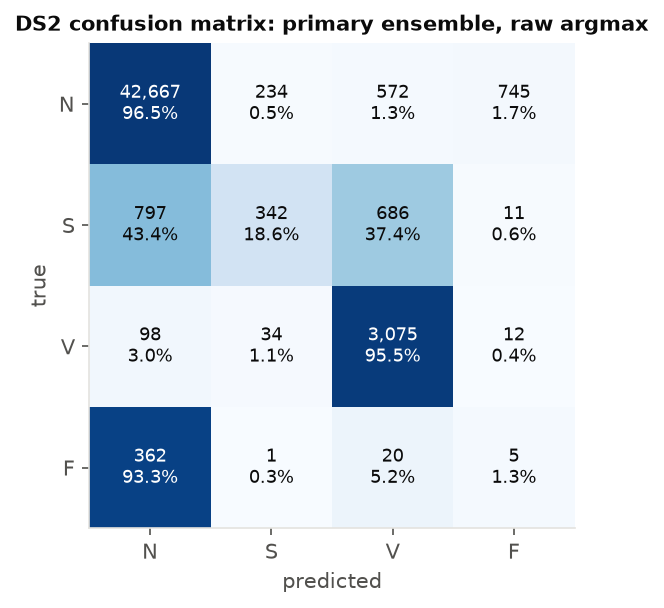
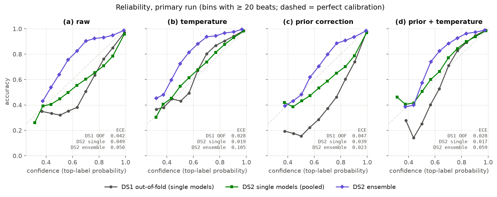

# ECG arrhythmia classification on MIT-BIH, tested on unseen patients

A compact 1D CNN (TensorFlow/Keras, 187k parameters) that classifies single
heartbeats into the AAMI classes N, S, V and F. The project's focus is the
evaluation: how well does it work on **patients it has never seen**, and how
far do common evaluation shortcuts overstate that?

**Headline.** On the 22 held-out patients of the standard inter-patient split
(de Chazal DS2), evaluated once with a pre-declared model and decision rule:
**macro-F1 0.52** (95% CI 0.44-0.61, bootstrap over patients). The same model
and config score **0.93** under the random-beat split used by much of the
literature. N and V transfer to new patients, S only partly, F not at all.



Everything is reproducible with one command (below). Every non-obvious choice,
including the ones that failed, is in [`docs/decisions.md`](docs/decisions.md).

---

## Contents
1. [Reproduce](#reproduce)
2. [Data and split](#data-and-split)
3. [Pipeline](#pipeline)
4. [How DS2 was kept clean](#how-ds2-was-kept-clean)
5. [Read this first: the F class](#read-this-first-the-f-class)
6. [DS2 results](#ds2-results)
7. [Where the errors come from](#where-the-errors-come-from)
8. [Calibration](#calibration)
9. [Leakage: why 0.93 and 0.52 are both "correct"](#leakage-why-093-and-052-are-both-correct)
10. [Limitations and next steps](#limitations-and-next-steps)
11. [Repository layout](#repository-layout)

---

## Reproduce

```bash
bash scripts/setup_env.sh        # conda env `ecg`: TF 2.21 + pip CUDA, env-scoped library path fix
bash scripts/run_all.sh          # download + verify data, 3 CV runs, DS2 evaluation, figures
```

`run_all.sh` takes about 25 minutes on an RTX 5090 (plus a one-time CUDA
kernel compile on the first run; TF 2.21 ships no sm_120 binaries).
Training refuses to start without a GPU (`scripts/check_gpu.py`), because TF
2.21's wheel silently fell back to CPU on this machine until a missing
library path was fixed. Seeds are fixed and op determinism is on: rerunning a
fold gives bit-identical logits. Checked end to end: `run_all.sh` in a fresh
clone (23 minutes) retrained every model and reproduced every committed
number, including the DS2 logits, exactly. Tests: `conda run -n ecg python -m pytest -q`.

The MIT-BIH data is downloaded from PhysioNet's AWS mirror and checked
against SHA-256 sums from physionet.org. It is never committed.

## Data and split

- **MIT-BIH Arrhythmia Database**, lead MLII, 360 Hz, 48 half-hour records.
  The four paced records (102, 104, 107, 217) are excluded, as is standard.
- **AAMI EC57 classes**: N (normal, bundle branch block, escape), S
  (supraventricular ectopic), V (ventricular ectopic), F (fusion of V and N).
  Q (unclassifiable; 8 beats in DS1, 7 in DS2) is excluded from training and
  metrics: too few to learn or to estimate anything about.
- **Inter-patient split (de Chazal et al., 2004)**: DS1 (22 records) for
  everything, DS2 (22 other records) for one final evaluation. The lists were
  checked against two independent references; `check_split()` asserts they
  are disjoint and cover the 44 records.

| Split | N | S | V | F |
|---|---|---|---|---|
| DS1 (train + validate) | 45,824 | 943 | 3,788 | 414 |
| DS2 (test, once) | 44,218 | 1,836 | 3,219 | 388 |

44 DS1 beats (0.09%) were dropped because their window crossed the record
edge or they had no previous/next beat for RR features (DS2: 44).

**Rare classes come from a handful of patients.** In DS1, record 208 holds 90%
of F beats and record 209 holds 41% of S beats. In DS2, record 213 holds 93%
of F beats and record 232 holds 75% of S beats. This shapes every number below.

## Pipeline

| Step | Choice | Why |
|---|---|---|
| Filter | Butterworth 0.5-40 Hz, order 2, zero-phase | Removes baseline wander, mains and EMG noise; zero-phase keeps R-peaks in place |
| Window | 250 ms before to 450 ms after the R-peak (252 samples) | Covers the P wave (key for S) through the T wave |
| Normalization | z-score per beat | Removes per-patient gain/offset using only that beat |
| RR features | pre-RR, post-RR, local mean RR (previous 10 beats), pre/local, post/pre; log, then z-scored with **training-fold** statistics | S beats are defined by timing, not shape. Ratios express prematurity relative to *this patient's* rhythm |
| Model | Conv stem, 3 residual blocks (32/64/128 filters), global average pooling; RR features through a dense layer; concatenated into a small head | Small enough for a wearable-class budget, and to overfit less on 22 patients |
| Imbalance | Class-weighted cross-entropy, weights ∝ sqrt(inverse frequency), from the training fold, mean weight 1 | Full inverse-frequency weights gave F ~1,000x the weight of N when a fold lost record 208 and wrecked the model (Run 1). Square root bounds that at ~32x |
| Training | AdamW (lr 1e-3, wd 1e-4), batch 256, mixed precision (fp16), ≤ 60 epochs, early stopping (patience 8) on validation macro-F1 over N, S, V | Validation is by patient. F is left out of the stopping metric because 4 of 5 folds have almost no F beats |
| Validation | 5-fold `StratifiedGroupKFold` over DS1 **records** | A single 4-patient validation split is too noisy; every DS1 patient is held out once |
| Final model | The 5 fold models, softmax outputs averaged | Uses all of DS1 while each model still has held-out patients for early stopping |

Post-RR means a beat is classified one beat late (~1 s). That is fine for
offline review (Holter), not for a real-time alarm.

## How DS2 was kept clean

DS2 was opened exactly once. Before that:

1. **No DS2-driven choices.** Preprocessing, folds, Q exclusion, model and
   training settings were decided on DS1 alone. DS2 class totals were counted
   for reporting only.
2. **A tuning budget, agreed in advance.** Run 1 (full inverse-frequency
   weights, stopping on weighted validation loss) failed on DS1. Run 2 fixed
   both causes. The budget allowed one more targeted fix. It wasn't used,
   because the remaining weakness (F) is a data limitation.
3. **Freeze, then pre-declare.** The config was frozen at commit `1e35d94`.
   The DS2 evaluation was then pre-declared in `docs/decisions.md` (commit
   `55e5fc8`) before any DS2 prediction existed:
   - the primary model: the early-stopped 5-model ensemble;
   - the decision rule: raw argmax;
   - the secondary and diagnostic models;
   - the bootstrap: resampling patients;
   - the four calibration variants.
4. **Checks enforced in code.** `python -m ecg.evaluate`:
   - refuses to run unless the data, model, training and config files are
     byte-identical to the frozen commit and the tree is clean;
   - records the commit it ran from;
   - refuses to overwrite an existing DS2 result.
   It was dry-run on DS1 first, which confirmed that reloaded models reproduce
   their stored out-of-fold logits (to 0.0025, fp16 rounding). The DS2 result
   was committed (`ce2334d`) before anything else was run.
5. **Literature comparison last.** The random-beat-split run trains on DS2
   beats, so it ran only after the DS2 result was committed.

## Read this first: the F class

F will score near zero on DS2. The reason is the data, not a bug. It also
shapes how the other numbers read.

- **F has a single patient source in DS1.** Record 208 contributes 373 of
  DS1's 414 F beats. Under patient-level CV, the model trained without 208
  sees 37 F beats and detects 0.5% of 208's F beats. The F the model learns is
  essentially "what fusion beats look like in patient 208". DS2's F beats
  come mainly from a different patient (213).
- **F turns into an "unfamiliar wide beat" class.** A fusion beat sits
  between a normal and a ventricular beat in shape. A model that has seen
  little F learns roughly "wide, but not quite V". It then assigns F to wide
  beats from patients whose morphology it hasn't seen, so F's PPV collapses.
- **AAMI labels bundle branch block beats as N.** Left and right bundle branch
  block beats (MIT-BIH `L`, `R`) are normal-rhythm beats with a wide QRS. AAMI
  counts them as N. A patient with LBBB therefore produces thousands of wide
  "N" beats that look closer to F or V than to a typical N:
  - in DS1, record 207 (LBBB) alone accounts for 1,223 N beats called F out of fold;
  - in DS2, record 214 (LBBB) gives 318 of the 745 N beats called F.

So on DS2, F sensitivity measures whether patient 208's fusion beats look like
patient 213's. F PPV mostly measures how many wide-QRS N beats DS2 contains.
Neither says much about the CNN. A useful F detector needs F examples from
many patients (e.g. INCART or a larger Holter set).

## DS2 results

Primary result: early-stopped 5-model ensemble, raw argmax. 49,661 beats from
22 unseen patients. 95% intervals come from a percentile bootstrap that
resamples **patients** (2,000 resamples), because patients are the unit of
generalization.

| Class | Sensitivity | PPV | F1 |
|---|---|---|---|
| N (44,218) | 0.965 [0.943, 0.984] | 0.971 [0.931, 0.997] | 0.968 |
| S (1,836) | 0.186 [0.101, 0.589] | 0.560 [0.333, 0.845] | 0.280 |
| V (3,219) | 0.955 [0.881, 0.985] | 0.706 [0.399, 0.896] | 0.812 |
| F (388) | 0.013 [0.001, 0.353] | 0.006 [0.001, 0.030] | 0.009 |
| **macro-F1** | | | **0.517 [0.436, 0.613]** |

Accuracy is 0.928. That is barely above always answering N (0.890), which is
why it isn't the headline.



**Other model sets** (pre-declared as comparison only; raw argmax, macro-F1):

| Model set | DS1 out-of-fold | DS2 |
|---|---|---|
| **Primary**: patient-level CV, early-stopped, 5-model ensemble | 0.565 (single models) | **0.517** [0.436, 0.613] |
| Single early-stopped fold models | – | 0.498 ± 0.056 (mean ± sd of 5) |
| Secondary: patient-level CV, fixed 12 epochs, ensemble | 0.507 | 0.577 [0.512, 0.606] |
| Diagnostic: **beat-level** CV models, ensemble | 0.929 | 0.524 [0.441, 0.625] |

- **The ensemble helps where the folds disagree.** Compared with the average
  single fold model:
  - N sensitivity rises from 0.904 to 0.965;
  - S PPV rises from 0.46 to 0.56;
  - V PPV rises from 0.66 to 0.71.

  S sensitivity does not improve: no fold model learned to recognize record
  232's S beats.
- **The DS1 ranking of early stopping vs fixed epochs flipped on DS2.**
  Out-of-fold on DS1, early stopping looked 0.06 better. On DS2, fixed epochs
  scored 0.06 higher:
  - paired patient bootstrap: +0.060, 95% CI [−0.037, +0.103];
  - most of the gap is record 232's S beats (S sensitivity there 0.34 vs 0.09).

  This fits the DS1 diagnosis that per-fold early stopping picks noise spikes
  in the validation curve. The primary result stays as declared. Switching now
  would be selecting on DS2.
- **Comparison with the original split paper.** de Chazal et al. (2004),
  using linear discriminants on hand-crafted features from both leads, report
  S Se 75.9% / PPV 38.5% and V Se 77.7% / PPV 81.9% on DS2. This model trades
  the other way: far fewer S detections but more precise, and higher V
  sensitivity at lower V PPV. Their operating point differs from raw argmax,
  so this is context, not a ranking.

Full tables: [`results/run2/ds2/ds2_summary.md`](results/run2/ds2/ds2_summary.md),
per patient: [`ds2_per_record.csv`](results/run2/ds2/ds2_per_record.csv).

## Where the errors come from

From the saved DS2 predictions
([`error_analysis.md`](results/run2/ds2/error_analysis.md)):

- **S is mostly one patient.** Record 232 has 1,381 of DS2's 1,836 S beats.
  The model detects 9% of them, and calls 674 N and 579 V. In record 232:
  - atrial premature beats are the dominant rhythm (1,382 S vs 397 N beats),
    and every N beat has right bundle branch block morphology;
  - a typical S beat elsewhere is premature and followed by a compensatory
    pause (median post/pre RR 1.59). In 232 they come in runs with no pause
    (median 1.02), and the patient's own "normal" beats are the ones after
    long pauses.

  The RR features the model leans on describe the opposite pattern.
  **Without record 232, S sensitivity is 0.47 and PPV 0.44.**
- **F:** 350 of record 213's 362 F beats are called N (see above).
- **N called F (745):** mostly 214 (LBBB, 318), 117 (184) and 202 (127).
- **N called V (572):** spread over 111 (LBBB, 134), 233 (113), 105 (86) and
  214 (68). Record 105 is known for heavy noise and artifact.

DS1 showed the same pattern. S misses were patient-specific there too (0 of
96 in record 118, 0 of 106 in 207), with LBBB patient 207 the largest source
of false F.

## Calibration

Class-weighted training shifts the predicted probabilities toward rare
classes: p_w(c | x) ∝ w_c · p(c | x). A single temperature cannot undo a
class-prior shift, so four variants were compared. All parameters were fit on
DS1 out-of-fold logits (T = 1.72, T′ = 1.84). For the ensemble, each model's
logits are adjusted first, then probabilities are averaged.

| Variant | DS1 out-of-fold, single models<br>ECE / NLL / Brier | DS2 single models (mean of 5)<br>ECE / NLL / Brier | DS2 ensemble<br>ECE / NLL / Brier | DS2 ensemble<br>macro-F1 · S Se / PPV |
|---|---|---|---|---|
| (a) raw | 0.042 / 0.413 / 0.157 | 0.049 / 0.414 / 0.192 | 0.050 / 0.270 / 0.130 | 0.517 · 0.19 / 0.56 |
| (b) temperature | 0.028 / 0.342 / 0.157 | 0.038 / 0.368 / 0.188 | 0.105 / 0.301 / 0.141 | 0.518 · 0.18 / 0.55 |
| (c) prior correction (logits − log w_c) | 0.047 / 0.317 / 0.125 | 0.039 / 0.327 / 0.130 | **0.023** / 0.239 / **0.096** | 0.486 · 0.06 / 0.68 |
| (d) prior correction + temperature | **0.028 / 0.245 / 0.115** | **0.025 / 0.268 / 0.127** | 0.059 / **0.232** / 0.101 | 0.487 · 0.06 / 0.72 |



- **For single models, the DS1-fitted corrections carry over to new
  patients.** Temperature lowers ECE and NLL, and prior correction lowers NLL
  and Brier further. (d) is best on all three metrics, on DS1 and on DS2.
- **For the ensemble, the pre-declared temperature rule backfired.** Averaging
  five models that disagree already softens the output. The raw ensemble is
  *under*-confident (its curve sits above the diagonal), and dividing each
  model's logits by T = 1.72 makes that worse: ECE rises from 0.050 to 0.105.
  T was fit on single-model logits, the only out-of-sample logits DS1 offers,
  since every DS1 beat was in training for 4 of the 5 models. Fitting a
  temperature for the ensemble properly needs patients that no ensemble
  member trained on: nested CV, or a separate calibration group.
- **Prior correction gives the best-calibrated ensemble, but changes the
  decisions.** It pulls predictions back toward N: S sensitivity falls to
  0.06, while PPV rises to 0.68. Calibration and the decision rule are
  separate questions. Calibrated probabilities feed a threshold chosen for the
  cost of a missed vs a false S alarm. That threshold must be set on
  validation patients, never on DS2.
- **Top-label ECE is dominated by N** (89% of beats) and says little about
  whether an S probability of 0.3 means 30%. Per-class reliability is a next
  step.

## Leakage: why 0.93 and 0.52 are both "correct"

Same data, model and code, with only the assignment of beats to folds
changed:

| Protocol | Test beats from patients seen in training? | macro-F1 | S F1 | F F1 |
|---|---|---|---|---|
| Random beat split over all 44 records (70/10/20) | yes (44 of 44 test patients) | 0.930 | 0.904 | 0.844 |
| DS1 CV, beat-level folds | yes | 0.929 | 0.913 | 0.837 |
| DS1 CV, patient-level folds | no | 0.565 | 0.465 | 0.010 |
| **DS2, unseen patients (primary)** | no | **0.517** | 0.280 | 0.009 |

With beat-level splits, every test patient also contributes thousands of
training beats. The model can recognize the patient's own morphology and
rhythm rather than the arrhythmia, so every class looks solved. The
beat-level-trained models score 0.929 under their own leaky CV and 0.524 on
DS2. The leaky estimate overstated new-patient performance by 0.40 macro-F1.
For a product that meets each user for the first time, the patient-level
number is the one that matters. The intra-patient number is an upper bound on
what personalization (adapting to a user's own labeled beats) could reach.

## Limitations and next steps

**Limitations**
- **22 test patients.** The confidence intervals are wide, and single
  patients (232 for S, 213 for F) dominate the rare-class results.
- **Annotated R-peaks.** Beats are cut at MIT-BIH's annotated R-peaks. A
  deployed system needs its own QRS detector, whose errors would add to these.
- **Offline signal processing.** Zero-phase filtering and post-RR are
  non-causal: fine for offline review, a one-beat delay for real time.
- **Lead MLII only.** A wearable single-lead ECG is a different lead
  placement and noise profile.
- **One optimistic DS1 estimate.** Early stopping on the same held-out
  patients makes the DS1 out-of-fold numbers optimistic. DS2 confirmed this.

**Next steps, in the order I'd do them**
1. **More patients for rare classes.** Train on DS1 plus other databases
   (INCART, the MIT-BIH Supraventricular DB), keeping DS2 or a fresh external
   set as test. This is the only real fix for F and the best lever for S.
2. **Calibrate the ensemble properly.** Nested patient-level CV so the
   ensemble's temperature is fit on patients no member saw. Add per-class
   reliability.
3. **Make decisions cost-sensitive.** Prior-corrected probabilities, with
   per-class thresholds chosen on validation patients for a target S
   sensitivity.
4. **Better S features.** Use P-wave features, and RR features that don't
   assume a compensatory pause. Record 232 shows that assumption fails when
   ectopy is the dominant rhythm.
5. **Patient-adaptive fine-tuning.** A few labeled beats per patient; the
   0.52 vs 0.93 gap bounds the possible gain.
6. **Steadier model selection.** Smooth the early-stopping signal or select
   the epoch on pooled validation. DS1 and DS2 both show the noisy per-fold
   selection costs accuracy.

## Repository layout

```
configs/default.yaml       frozen config (Run 2); configs/run1.yaml = the failed first run
ecg/data.py                download + checksum, split check, filtering, beats, RR features, folds
ecg/model.py               two-input residual 1D CNN
ecg/train.py               patient-level / beat-level CV training (DS1 only)
ecg/evaluate.py            metrics, ECE, temperature, prior correction, bootstrap, the DS2 evaluation
scripts/run_all.sh         the end-to-end command
scripts/                   GPU check, dataset build, DS1 inspection, summaries, literature run, figures
tests/                     12 tests: RR features, beat drops, fold disjointness, metrics, calibration
docs/decisions.md          every decision, in order, with what was rejected and why
results/                   all tables and figures (committed); runs/ and data/ are not
```

## References
- de Chazal P, O'Dwyer M, Reilly RB. *Automatic classification of heartbeats
  using ECG morphology and heartbeat interval features.* IEEE Trans Biomed Eng
  51(7), 2004. Source of the DS1/DS2 split and the DS2 baseline above.
- Moody GB, Mark RG. *The impact of the MIT-BIH Arrhythmia Database.* IEEE Eng
  Med Biol 20(3), 2001. Goldberger AL et al. *PhysioBank, PhysioToolkit, and
  PhysioNet.* Circulation 101(23), 2000.
- ANSI/AAMI EC57: testing and reporting performance results of cardiac rhythm
  and ST-segment measurement algorithms (AAMI beat classes).
